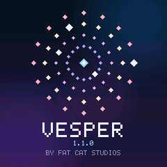
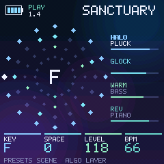
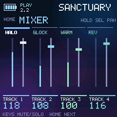
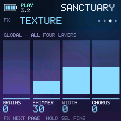

# VESPER

An ambient worship firmware for the M-VAVE FM-1, by Fat Cat Studios.

   

Each of VESPER's 16 scenes stacks four lush voices around a key. Everything stays in a major key you choose. Play the voices live over the scene, record into it, and shape the whole mix with a global effects chain built for pads and atmosphere.

- **Identity:** `FM-1_8837020000` (2.0.0)
- **Built on:** [fm1-base](https://github.com/charlesvestal/fm1-base) and felucca-bsp (MPL-2.0). VESPER's own code and the open FM1 engine it plays through are GPL-3.0 with the FM1 SDK linking exception.
- **Samples:** piano, marimba and glockenspiel from Versilian Studios VSCO-2 Community Edition (CC0). They are built into the firmware, so there is nothing extra to install.

## Controls

| Control | What it does |
|---|---|
| **HOME** | Press once for the crystal orbit: the four layers turn as rings around the key. Press again for the 4-track mixer. |
| HOME knobs | K1 sets the key. K2 sets **SPACE**, one knob that adds grains, shimmer, reverb, echo and a cleaner low end. K3 sets the layer level and K4 the BPM. |
| **PRESETS** knob | Steps through the 16 scenes. **Hold SEL** and turn it to step through your saved user presets. |
| **SEL** (hold) | Every knob moves one fine step per click while it is held. On the mixer, the faders become pan. |
| **ARP** | Switches the keys between setting the key and playing the focused voice live. A green **PLAY** badge shows on HOME. |
| **REC** | Records what you play into the sequence. Works while playing (ARP on). |
| **ALGORITHM** | Picks which of the four voices the EDIT, ENV and LFO pages show. |
| **EDIT** | Five pages per voice: SOUND, TONE, OSC, VOICE and MIX (level, pan, reverb send, echo send). |
| **ENV / LFO** | Amp and filter envelopes; tempo-synced filter motion, autopan and analog drift. |
| **FX** | The global chain, one page per press: **DIRT**, then **TONE**, **TEXTURE** and **VERB + DELAY**. |
| **GLO** | Clock and MIDI settings, swing, click and **THEME** (Crystal, Ember, Forest, Mono). SELECT scrolls; ALGORITHM or K1 changes the value. |
| **SAVE** | Saves to 16 user slots, with your sounds, FX and SPACE. Rename it if you like: it keeps its scene. |

The global effects:

- **DIRT:** drive (%), bits (16 down to 4), sample rate (kHz) and mix.
- **TONE:** high pass, low pass, a gentle 2:1 compressor and output trim.
- **TEXTURE:** a tempo-synced granular cloud, octave shimmer, stereo width and chorus.
- **VERB + DELAY:** plate reverb and a tape-style stereo echo. Each voice has its own sends on EDIT, MIX.

## Installing

Install from the [FM-1 Firmware Hub](https://thefirmwarehub.com), or open `FM1-VESPER-2.0.0-Installer.html` from the release in Chrome or Edge, connect the FM-1 by USB and press **Install**.

- It installs over M-VAVE's original V15 or another open firmware.
- To leave VESPER, use **Back to the stock firmware** on the same page with M-VAVE's `FM-1.fwsc`, or install any other firmware.
- If the FM-1 ever will not start, hold **REC** while switching it on for the chip's own update mode.
- Projects saved in VESPER 1.x do not carry over to 2.0.

## Building

```
git clone --recursive https://github.com/fatcatstudios-hub/vesper-fm1
JIELI_TOOLCHAIN=/path/to/jieli-linux-toolchains AC79_SDK=/path/to/ac79-sdk tools/build.sh --release 2.0.0
python3 tools/make_installer.py build/vesper-2.0.0.fwsc 2.0.0 FM1-VESPER-2.0.0-Installer.html
tools/build.sh --host        # the simulator: build/host/vesper_host SCRIPT OUTDIR
```

- `AC79_SDK` is JieLi's AC79 SDK (gitee.com/Jieli-Tech/fw-AC79_AIoT_SDK, AC79NN_SDK_V1.2.1).
- Three of its files go into the package. `tools/sdk_from_fwsc.py` can take them from any Felucca-family `.fwsc`, checked against JieLi's hashes.
- `tools/build.sh` refuses to make a package with any other copy of those three files.

Most of VESPER lives in a few places:
- `vesper/app/lush.c`: the synth engine and effects
- `vesper/app/screen.c`: the user interface
- `vesper/app/presets.c`: the scenes
- `vesper/port.c`: the FM-1 underneath (fm1-base)

## Credits

- FM-1 hardware, and the FM1 Open engine VESPER plays through: M-VAVE.
- fm1-base: Charles Vestal. felucca-bsp and Felucca: Leo Kuroshita (Hügelton Instruments) and contributors.
- Samples: Versilian Studios VSCO-2 Community Edition (CC0).
- FM-1 web emulator: Joakim Eriksson.
